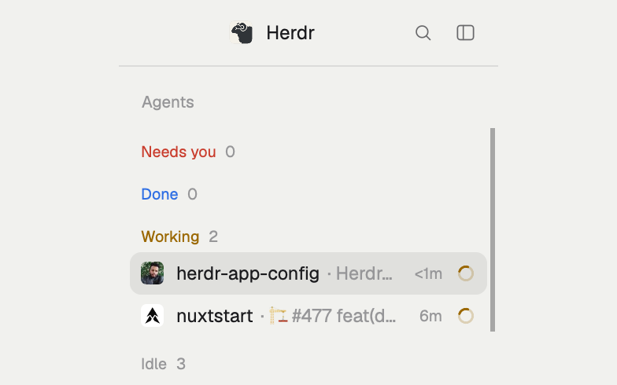

# Agent triage

A [Herdr app](https://herdr.dev) Agents sidebar: your agents ranked by what needs you, in
sections that fold (Needs you, Done, Working, Idle).



## Add it

Tell your agent:

```
Read ~/.config/herdr-app/AGENTS.md, then add this mod: herdr.dev/mods/jd-solanki/herdr-app-config--apps--agent-triage
```

It replaces Herdr's own Agents list: the layout block with `"mod": "agents"` gets
`"mod": "agent-triage"`. If you're on Herdr's `main` layout, your agent clones it first.

It pairs with [`spaces-avatars`](../spaces-avatars/): with it, rows show each repo's name and
its GitHub owner's avatar; without it, the space name and the agent's program icon.

[RECIPE.md](./RECIPE.md) is the full brief.

## Credit

Built from the `agents` mod of the [Herdr app](https://github.com/herdrdev/herdr-app)
(Apache-2.0). See [NOTICE](./NOTICE).
