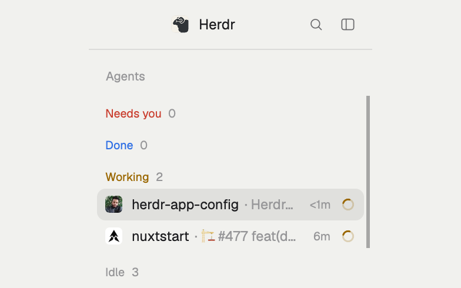

# Agent triage

Your agents sorted by what needs you: a list in four sections that fold, Needs you, Done, Working and Idle, with the most urgent one open. A parent agent rises with its most urgent sub-agent, and an agent you finished looking at stays where you found it until you leave. It takes the place of Herdr's own Agents list in your sidebar; it isn't a new window.

This file is the brief: enough to build Agent triage from an empty folder. The files next to it are one build of it. If they don't work on your Herdr, or you want it different, build it again from here.

## What you see

The mod fills its block, on the theme's `chrome` background with a 1px `border` line on top. Text is 13px.

- **A heading**, "Agents" (11.5px, medium, `dim`), in a 41px strip with 16px side padding.
- **Sections**, in this order, each a 30px header (11px medium, 8px side padding, 8px above): its name and how many agents it holds (`dim`), and, while folded, a right chevron (11px, `dim`) at the far end.
  - "Pinned" (`dim`), only while an agent is pinned.
  - "Needs you" (`blocked`), "Done" (`done`), "Working" (`working`), "Idle" (`dim`). These four always show, even empty, so the list doesn't jump.
- **Agent rows**, 30px high, 8px side padding, 8px radius, 9px gaps; the focused agent's row on `selected`, any row on `hover` under the pointer. From the left:
  - a 16px picture: the space's GitHub avatar (4px radius) when the `spaces-avatars` mod provides one, else the agent's program icon (a one-color glyph in `foreground`, or its image);
  - the space's name, its repo when `spaces-avatars` knows it (up to 200px, 120px when a detail follows), in `foreground`, or `muted` for an idle agent you aren't on;
  - "· detail" in `dim`: a tab someone named or the agent's own title, never an automatic tab number unless two rows would otherwise read the same;
  - for an agent on another machine (address `vps/t7`), the machine's name (10px, `dim`);
  - for an agent with sub-agents, a fold chevron (11px; folded, it shows how many, colored by the most urgent of them);
  - how long ago its state last changed, "<1m", "5m", "3h", "2d" (11px, `dim`); under the pointer, a 13px pin button instead ("Pin to the top" / "Unpin");
  - its status mark.
- **Status marks.** Working: a 12px spinner in `working`, turning every 900ms. Needs you: a pill "Needs you" (18px high, 5px radius, 10.5px semibold `blocked` on `blocked` at alpha `26`) on pinned rows; elsewhere, where the header already says it, a 14px "!" square in the same colors. Done: a 7px `done` dot. Idle: a 7px ring, 1.5px `idle`.
- **Sub-agent rows**, under their parent: 26px high, 39px indent, 12.5px text, with tree lines (1.5px `input`, a 6px rounded corner on `├` and `└`), a 14px program icon, the sub-agent's name in `muted` (`foreground` while it's the one shown), and its compact status mark.
- **No agents yet:** "No agent status yet. Agents show up here when they report their status. Older versions and agents inside tmux may not." (12px, `dim`).
- **Narrow sidebar** (the layout's `sidebar` node under 160px): no heading, sections or sub-agents. Each agent is a 26px row with its 1-based number (`muted`, right-aligned) and its compact status mark, and a "»" (13px, `dim`) at the bottom.

## How it behaves

- **Order.** An agent's urgency is the most urgent of itself and its live sub-agents: Needs you (blocked) above Done, above Working, above Idle. A sub-agent's error counts as Needs you and its done as Idle: it reports to its parent, and the parent's done is the news. Within a section, the most recent state change comes first, then the most recently changed terminal. Pinned agents come first, in the same order. Herdr's next/previous agent keys walk the list in this order.
- **Seen, not moved.** Looking at a done agent turns it idle; it stays in Done until you leave it, then moves. Any other change moves it at once. Done and idle count as one state for "how long ago", since looking isn't the agent doing anything.
- **Folding.** The first time there are agents, every section starts folded except the most urgent one that has any; after that, each folds when you click its header and stays as you left it. Clicking an agent's fold chevron, or its picture, folds its sub-agents.
- **Clicks.** An agent row focuses its pane. A sub-agent row peeks at its terminal. The pin button pins or unpins the agent's terminal on every Herdr client.
- **Narrow sidebar.** "»" widens the sidebar back to the width it had (268px if none was saved).
- **Live.** The list follows agents as they report. The "how long ago" times refresh every 30 seconds. State-change times survive a restart and are dropped 30 days after an agent is gone.

## Built from

- **One mod**, `mods/agent-triage/`, with `main.js` and `mod.json` (`"place": "none"`, `"title": "Agents"`). It replaces Herdr's own `agents` mod in an existing layout block: in the person's layout, the block whose `content` is `{ "mod": "agents" }` gets `{ "mod": "agent-triage" }`. Nothing else in the layout changes.
- **A view** using `gpui-kit` (`div`, `svg`, `image`) and `gpui-base` (`v_flex`, `h_flex`), colored only from `theme()`.
- **Herdr data:** `agents()` for the list, `terminals()` for sub-agents (`parent`, `state`) and pins, `panes()` and `spaces()` for tab names, `focused()` for the shown agent, `layout()` for the `sidebar` node's width, `window()` for the platform.
- **Commands:** `pane.focus {pane}`, `terminal.peek {terminal}`, `terminal.pin {terminal, pinned}` and `layout.resize {id: "sidebar", px}`. `setAgentOrder()` hands the shown order to next/previous agent.
- **Shared state.** Reads `space.repos` and `space.avatars` (space id to repo name and to avatar image path), written by the companion `spaces-avatars` mod. Writes `sidebar.width` and `sidebar.collapsed` when "»" is clicked.
- **Its own storage:** `localStorage` keys `changed` (each agent's last state and when) and `pins` (old local pins still moving onto terminal labels).
- **Art:** Herdr's shipped `mods/workspace-chrome/` icons `spinner.svg`, `chevron-down.svg`, `chevron-right.svg`, `pin.svg` and `pin-off.svg`.
- It runs no programs, makes no network requests and reads no files.

## Watch out

- **Replace, don't add.** Put it in the block that has Herdr's `agents` mod; with `"place": "none"` it docks nowhere by itself. If the person's layout is Herdr's own `main`, which is read-only, clone it first, `herdr-app do layout.clone '{"name":"main","as":"<name>"}'`, and change the clone.
- **Without `spaces-avatars`** rows show Herdr's space names and program icons instead of repo names and owner avatars. Nothing else changes.
- **The narrow mode needs a layout node with id `sidebar`.** Without one the list never goes narrow and "»" never shows.
- It draws Herdr's `workspace-chrome` icons by path: a Herdr version that moves them shows blanks.
- Section folds live in memory: after a restart the sections start folded again around the most urgent one.
- `herdr.d.ts` types `theme()` as plain strings; they are `#rrggbb` colors, and the alpha pill appends two hex digits.
- If a mod named `agent-triage` already exists, rename the folder and the layout's `mod` together.

## Done when

- `herdr-app check mods/agent-triage` passes.
- With the block switched, the sidebar shows "Agents" and the four sections, in order, even with no agents in them; a pinned agent adds "Pinned" above.
- An agent that asks for input moves to Needs you at once, with a "!" mark; a pinned one shows the "Needs you" pill.
- A finished agent sits in Done with a dot; focusing it keeps it in Done until you focus another, then it drops to Idle with a ring.
- A parent whose sub-agent is blocked sits in Needs you; its sub-agents show under it with tree lines and fold from its chevron.
- Clicking a section header folds it; clicking a row focuses that agent's pane; next/previous agent follow the list's order.
- With `spaces-avatars` installed, rows show the repo name and its owner's avatar; without it, the space name and program icon.
- Narrowing the sidebar below 160px shows numbered rows and "»", which widens it back.
