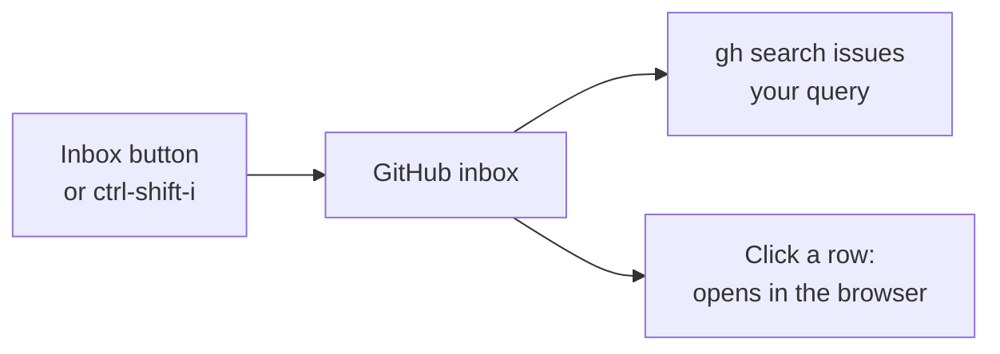

# GitHub inbox

A [Herdr app](https://herdr.dev) mod: open issues and PRs from every repo your GitHub account
sees, in one list, from one GitHub search. It starts on what's assigned to you.




## Add it

Tell your agent:

```text
Read ~/.config/herdr-app/AGENTS.md, then add this mod: herdr.dev/mods/jd-solanki/herdr-app-config--apps--github-inbox
```

`ctrl-shift-i` opens it as a tab. With [tab-bar](../tab-bar/) it also gets an **Inbox** button
in the tab bar, and your agent offers to add tab-bar.

This repo's [`workspace` layout](../../src/layouts/) puts it in the right side panel instead of
a tab. **Inbox** switches the panel to it, like Files and Changes, and the panel stays as you
left it when you switch spaces.

## Use

It needs `gh`, logged in.

- It starts on `state:open assignee:@me`. Type any GitHub search query and press Enter; the
  inbox keeps your query across restarts.
- Typing a word with a `:` (`is:`, `review:`) suggests its values, and label names after
  `label:`. Enter or Tab takes the highlighted one.
- Click a row to open it in the browser.
- It refreshes every minute.

[RECIPE.md](RECIPE.md) describes it exactly, enough for an agent to build it again.

## Credit

Icons from [Lucide](https://lucide.dev) (ISC). See [NOTICE](NOTICE).
