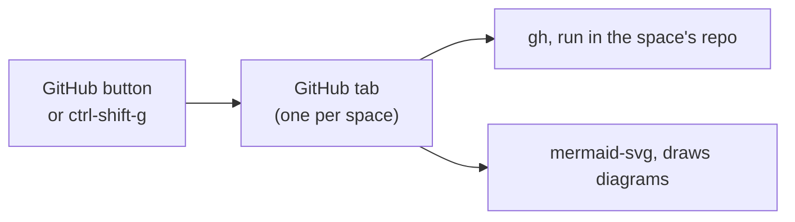

# GitHub tab

A [Herdr app](https://herdr.dev) mod: a GitHub tab for each space. It lists the issues and PRs of the repo that space
is in, and opens them inside the app, Mermaid diagrams and images included.




## Add it

Tell your agent:

```text
Read ~/.config/herdr-app/AGENTS.md, then add this mod: herdr.dev/mods/jd-solanki/herdr-app-config--apps--github
```

`ctrl-shift-g` opens it as a tab in the shown space. With [tab-bar](../tab-bar/) it also gets a
**GitHub** button that goes back to the space's tab.

## Use

It needs `gh`, logged in, and `bun` for diagrams. `gh` runs in the space's repo, so the account
follows that repo. The first diagram needs network, because `bun` downloads Pele then.

- Click **GitHub**, or press `ctrl-shift-g`. It opens the space's GitHub tab, or goes
  back to it.
- Close it like any other tab.
- The chips set the search box. Type any GitHub search query there and press Enter.
- A new tab opens on the kind and query used last, in any space.
- Typing a word with a `:` (`is:`, `no:`) suggests its values, and label names after `label:`. Enter or Tab
  takes the highlighted one; with no suggestion showing, Enter searches.
- Click a row to read it in the app. The ↗ button opens the browser.
- Click a row's labels to pick them. It shows the first few labels; type to find the rest. Ticking does nothing until
  the picker closes, which saves every change in one call.
- Images show as 🖼 links. One hosted on GitHub (github.com, *.githubusercontent.com) also shows as a thumbnail under the post; click either to see it full size, and Esc closes it. Any other image stays a link that opens in the browser, so its host never learns when you read the post.

[RECIPE.md](RECIPE.md) describes it exactly, enough for an agent to build it again.

## Credit

State icons from [Lucide](https://lucide.dev) (ISC). See [NOTICE](NOTICE).
