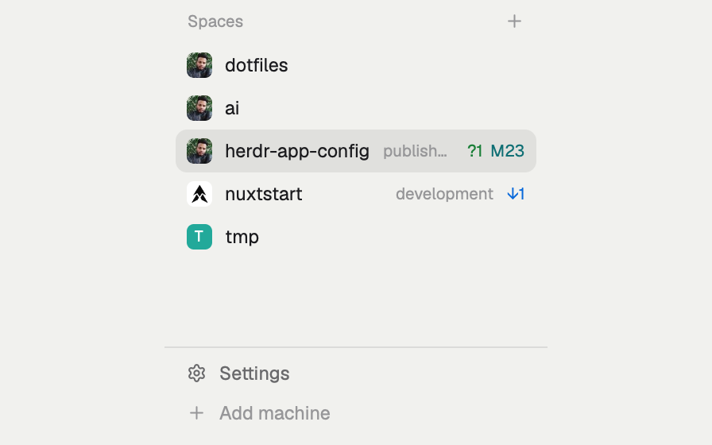
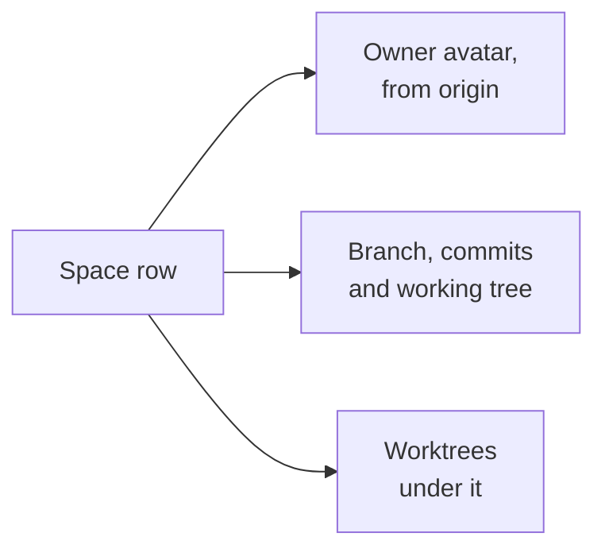

# Spaces with avatars

A [Herdr app](https://herdr.dev) mod: Herdr's Spaces list, with each repo's GitHub owner as
its avatar and the repo's git state after its name. Worktrees sit under their main checkout.





## Add it

Tell your agent:

```text
Read ~/.config/herdr-app/AGENTS.md, then add this mod: herdr.dev/mods/jd-solanki/herdr-app-config--apps--spaces-avatars
```

It replaces Herdr's own Spaces list: your agent puts `spaces-avatars` in the sidebar block
that shows `spaces`, in a clone of your layout if you're on Herdr's `main`.

It pairs with [agent-triage](../agent-triage/), our Agents list, which shows the same avatars
and names.

## Use

It needs `git` and `curl`, and no GitHub login: avatars are public. A space with no GitHub
`origin` keeps Herdr's letter tile.

- After a space's name, only what's unusual: the repo, a branch other than `main` or
  `master`, then `↓` behind and `↑` ahead, and `?` untracked, `M` modified, `D` deleted, `U`
  unmerged files, as a shell prompt's git segment shows them.
- Click a space to show it, drag to reorder, right-click for its menu.
- In a sidebar narrower than 160px, it's a numbered rail with a `●` on spaces that need you.

[RECIPE.md](RECIPE.md) describes it exactly, enough for an agent to build it again.

## Change it

Avatars are cached in the installed mod's hidden `.avatars/` folder.

`herdr-app check` renders with no spaces, so it can't catch a bug in a row. Look at the
sidebar to test.

## Credit

A clone of the `spaces` mod 0.1.11 that ships with the [Herdr app](https://github.com/herdrdev/herdr-app)
(Apache-2.0), so Herdr's updates never reach it. `cloned_from` in its `mod.json` records the
version; to take an update, compare it with `~/.config/herdr-app/mods/spaces/main.js`. See
[NOTICE](NOTICE).
