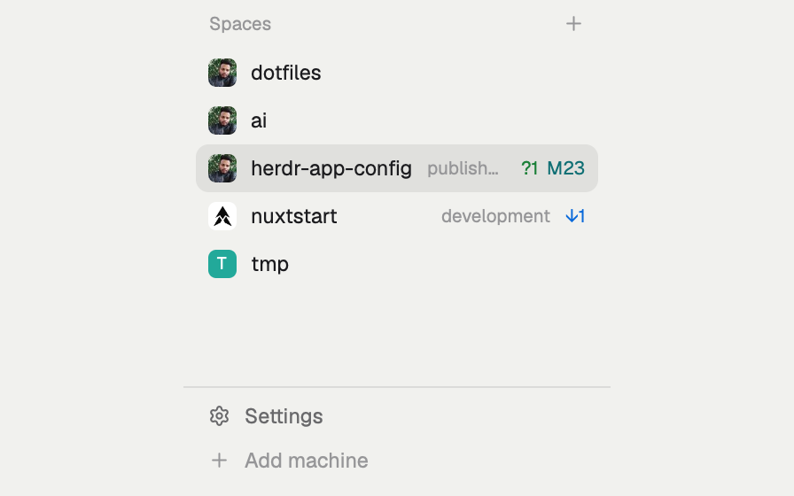

# Spaces with avatars

Herdr's Spaces list, with each repo's GitHub owner as its avatar and the repo's git state after its name: branch, commits ahead and behind, untracked, modified, deleted and unmerged files. Worktrees sit under their main checkout. It takes the place of Herdr's own Spaces list in your sidebar; it is not a new window.

This file is the brief: enough to build Spaces with avatars from an empty folder. The files next to it are one build of it. If they don't work on your Herdr, or you want it different, build it again from here.

## What you see

- A header, 31px high, 16px in from the left and 10px from the right: "Spaces" in the theme's dim color at 11.5px, and on the right a 26px "+" button (Herdr's `plus.svg`, 14px, 6px radius) that makes a new space. Behind it the sidebar's `chrome` color; text is 13px.
- Below, a scrolling list, 8px in from each side with 14px at the bottom, its scrollbar always shown.
- One row per space, 30px high, 8px radius, 8px in from each side, 9px between its parts:
  - An 18px avatar with a 5px radius: the GitHub owner's picture when the space's repo has a github.com `origin`, else a tile in the space's color with its first letter, bold, white, 10.5px. The tile colors are fixed per hue in light and dark themes: `#22a99a`, `#e3814f`, `#5b8def`, `#8b7cf6`, `#3fae6a`, `#d9649a`.
  - The name in the theme's foreground, cut off at 150px. A space nobody named shows its repo's name, not Herdr's name for a worktree (its folder).
  - On the right, at 11.5px in the dim color, only what is unusual: the repo when the name doesn't already say it, and the branch unless it is `main`, `master` or the name itself ("detached" without one), joined by " · ".
  - Then the counts, 5px apart, each only when above zero: `↓` behind in `ansi12`, `↑` ahead in `ansi13`, a " · ", then `?` untracked in `ansi2`, `M` modified in `ansi6`, `D` deleted in `ansi1`, `U` unmerged in `ansi9`. For example "herdr · spike ↓1 ↑2 · ?3 M2".
- A worktree's row sits under its main checkout's, 28px high and 22px further in, with Herdr's `branch.svg` (13px, dim) in place of the avatar.
- The shown space's row has the `selected` background; others get `hover` under the pointer.
- Once any space lives on another machine, or `hc machine ls` knows one, the rows are grouped under a 26px header per machine: a `monitor.svg` ("This computer") or `server.svg` icon at 13px, the machine's name, its state when it isn't connected ("asleep", "unreachable"…), a "+" for a new space there while it is connected, a 6px dot (`ansi2` when connected, dim when not) and a fold chevron. A machine with no spaces shows "New space there"; one still loading shows "Loading…".
- In a sidebar narrower than 160px, a rail: each space is a 26px row with its number and a status mark, the shown one on the `raised` color. The header keeps only its "+".

## How it behaves

- Agent status shows only in the narrow rail, as the space's most urgent status: a `●` for blocked and done, a `·` for working and idle, in the theme's color for that status (`unknown` when there is none). The wide rows leave agent state to the Agents list.
- Click a row to show that space. Drag a row onto another of the same machine to move it there: the dragged row fades to half while it is away, and a 2px accent line marks where it lands. Right-click a row for Herdr's own space menu. "+" makes a new space, on that machine under a machine header.
- Click a machine header to fold it; folds are kept across restarts.
- A space made while the list is open waits up to 1.5s for its git, so a worktree appears under its checkout instead of jumping there.
- Git is read only when it could have changed: for a new place (a new space, or its first terminal moved to another folder), when a pane in that repo stops working (an agent's turn or a command ends), when a machine comes back, when a local repo's git folder changes (a commit, a checkout; a plain edit doesn't touch it), and every 60s for repos in view while the window is in front and their machine isn't folded. A commit in one worktree updates the counts of the others in the same repo.
- Avatars appear from the cached file at once and are fetched again once per run, so a changed GitHub picture shows from the next start.
- Machines are listed again every 15s; temporary ones (an agent's sandbox) are left out.
- Nothing moves on its own: there are no animations.

## Built from

- **One mod**, `mods/spaces-avatars/`, with `main.js` and `mod.json` (`place: "none"`, title "Spaces"). It goes in the block of the person's layout that shows Herdr's Spaces list.
- **Elements:** `View`, `div`, `image` and `svg` from `gpui-kit`; `v_flex` and `h_flex` from `gpui-base`; colors from `theme()`.
- **From `herdr`:** `spaces()`, `panes()` (each terminal's live folder), `machines()` (whose layout is ready), `layout()` (the `sidebar` node's width), `window()` (in front or not), `watchFolder()`, `exec()`, `hc()`, `appHome()`, `openOverlay()`, `shared()` and `setShared()`.
- **Commands:** `space.new` (with `{ machine }` for another machine), `space.select` and `space.move { id, index }`; the right-click menu is Herdr's `menu` mod as a 200×260 popup with `{ tab: "space", target: { id } }`.
- **Programs it runs**, through `exec` on the space's machine:
  - `git --no-optional-locks -c core.fsmonitor=false status --porcelain=v2 --branch` (so it never writes under `.git` and wakes its own watch), `git rev-parse --show-toplevel`, `git rev-parse --path-format=absolute --git-common-dir` (the main checkout and its worktrees share it) and `git remote get-url origin`.
  - `curl -fsSL --max-time 10 --create-dirs -o <file>.tmp https://github.com/<owner>.png?size=54`, then `mv` over the cached file, and `test -s` to see whether one exists. The picture is fetched at 3× its 18px for sharp screens.
  - `hc machine ls --json` for the machines.
- **Shared state it writes:** `space.avatars` (space id → cached picture) and `space.repos` (space id → the name it shows), which the companion [agent-triage](../agent-triage/) mod reads to show the same avatars and names. `space.colors` (space id → color) is Herdr's own key, the one its Spaces list and picker use: each new space gets the least-used of the six colors, and removed spaces are dropped.
- **Art:** Herdr's shipped `mods/workspace-chrome/` icons `plus`, `branch`, `monitor`, `server`, `chevron-down` and `chevron-right`. The folded machines are kept in the mod's `localStorage` under `machines.folded`.

## Watch out

- **It replaces Herdr's Spaces list.** In the person's layout, set the block whose content is `"mod": "spaces"` to `"mod": "spaces-avatars"`. If their layout is Herdr's read-only `main`, first clone it, `herdr-app do layout.clone '{"name":"main","as":"<name>"}'`, and change the clone. Don't show both.
- **It reaches the network and runs programs:** `curl` to github.com for public avatars, no login or token; `git` in every space's folder, on other machines too; `hc` for the machines.
- Avatars are cached in `mods/spaces-avatars/.avatars/`, hidden because any other new file in a mod's folder reloads the mod. The path names the folder: if the mod is renamed, change `AVATARS` in `main.js` too.
- Only a github.com `origin`, over HTTPS or SSH, gets an avatar; the owner must be letters, digits, `_` or `-`, so a remote URL can never reach the file path. Every other space keeps its letter tile.
- The narrow rail needs a layout node with the id `sidebar`; without one the list is always wide.
- It is a clone of Herdr's `spaces` mod 0.1.11 (`cloned_from` in `mod.json`), so Herdr's updates don't reach it. Herdr's own list has since gained things this one doesn't have, such as reconnecting a machine.
- `herdr-app check` renders with no spaces, so it can't catch a bug in a row; look at the sidebar. The check also writes `jsconfig.json` and `gpui-kit.d.ts` into the folder it checks: don't ship them.

## Done when

- `herdr-app check mods/spaces-avatars` passes.
- The layout's Spaces block shows this list and Herdr's own list is gone; `ctrl-shift-l` still reaches the person's earlier layout.
- A space in a repo with a github.com `origin` shows its owner's picture after the first fetch, and again straight away on the next start; a space outside GitHub shows its colored letter tile.
- A worktree's space is listed under its main checkout with the branch icon, and an unnamed one shows the repo's name.
- An agent's turn or a command that edits a tracked file adds `M1` to its space when it ends (an edit from outside Herdr shows within 60s); committing turns it into `↑1` at once, through the git folder's watch.
- Clicking selects a space, dragging moves it, right-clicking opens the space menu and "+" makes one.
- Narrowing the sidebar below 160px shows the numbered rail, with `●` on a space whose agent is blocked or done.
- With agent-triage installed, the Agents list shows the same avatars and names.
