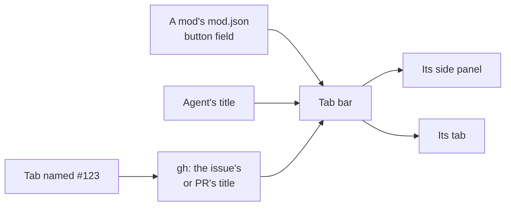

# Tab bar

A [Herdr app](https://herdr.dev) mod: Herdr's tab bar, with better tab names and room for other
mods' buttons. An unnamed tab shows its agent's own title, and a tab you name `#123` takes that
GitHub issue's or PR's title.




## Add it

Tell your agent:

```text
Read ~/.config/herdr-app/AGENTS.md, then add this mod: herdr.dev/mods/jd-solanki/herdr-app-config--apps--tab-bar
```

It replaces Herdr's own tab bar: your agent points the layout's `tabs` block at `tab-bar`, in a
clone of your layout if you're on Herdr's `main`.

It pairs with [GitHub tab](../github/) and [GitHub inbox](../github-inbox/), which add their
buttons.

## Tab names

It needs `gh`, logged in, for `#123` tabs.

- An unnamed tab shows its agent's own title (Claude Code sets one per session), unless the title
  is a path, `user@host` or the program name. The tab stays unnamed, so the title follows the
  agent.
- Name a tab `#123` and it becomes `🛠️ #123 <title>`, or `🔀 #123 <title>` for a PR. The name
  must be exactly `#` and digits, and `gh` reads the repo from the tab's focused terminal's
  folder, so open the tab in the clone first.
- A failed lookup shows a toast. Rename the tab away and back to retry.

## Add a button from your mod

Put a `button` field in your mod's `mod.json`. Herdr ignores it; the tab bar reads it.

```json
{ "place": "none", "button": { "label": "Inbox", "icon": "mods/my-mod/inbox.svg" } }
```

- `icon` is a path under `~/.config/herdr-app`. `per_space: true` passes the space as
  `props.space` when it opens your mod.
- The button toggles your mod's side panel when the layout's `panel-body` stack has a block
  with your mod's name as its id; otherwise it goes to your mod's tab in the space, or opens one.
- Bind a key to it with `"tab-bar.<your mod>"` in `keys.json`.

Set `"props": { "buttons": ["my-mod", "other-mod"] }` on the tab bar's layout block to pick and
order the buttons; without it, every declared button shows.

[RECIPE.md](RECIPE.md) describes it exactly, enough for an agent to build it again.

## Credit

A clone of the `tabs` mod 0.1.11 that ships with the [Herdr app](https://github.com/herdrdev/herdr-app)
(Apache-2.0), so Herdr's updates never reach it. See [NOTICE](NOTICE).
