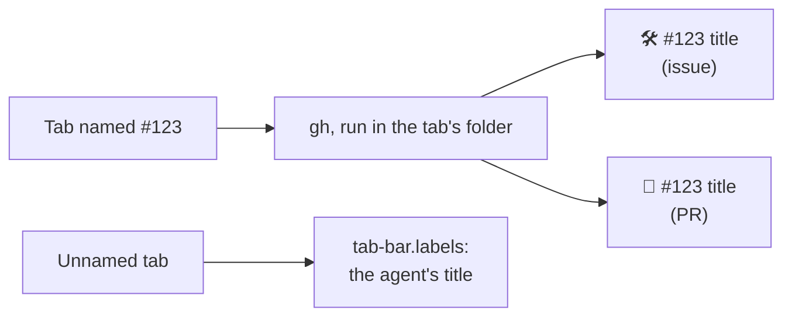

# Tab title

A [Herdr app](https://herdr.dev) mod: a tab you name `#123` takes that issue's or PR's title,
and an unnamed tab shows its agent's own title.




## Add it

Tell your agent:

```text
Read ~/.config/herdr-app/AGENTS.md, then add this mod: herdr.dev/mods/jd-solanki/herdr-app-config--apps--tab-title
```

It draws nothing: your agent adds it to your layout as a 0px block, in a clone of your layout if
you're on Herdr's `main`.

## Use

It needs `gh`, logged in, and runs only while a layout with its block is shown.

- Name a tab `#123` and it becomes `🛠️ #123 <title>`, or `🔀 #123 <title>` for a PR. The name
  must be exactly `#` and digits.
- `gh` reads the repo from the tab's focused terminal's folder, so open the tab in the clone
  first.
- A failed lookup shows a toast. Rename the tab away and back to retry.
- With [tab-bar](../tab-bar/), an unnamed tab shows its agent's own title (Claude Code sets one
  per session), unless the title is a path, `user@host` or the program name. The tab stays
  unnamed, so the title follows the agent.

[RECIPE.md](RECIPE.md) describes it exactly, enough for an agent to build it again.
