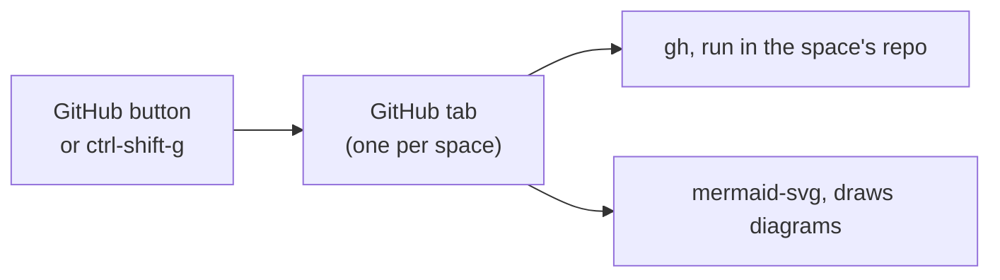

# Herdr GitHub tab

A GitHub tab for each Herdr space. It lists the issues and PRs of the repo that space
is in, and opens them inside the app, Mermaid diagrams and images included.

## Use

`gh` runs in the space's repo, so the account follows that repo. `mermaid-svg` runs on `bun`;
the first diagram needs network, because `bun` downloads Pele then.

- Click **GitHub**, or press `ctrl-shift-g`. It opens the space's GitHub tab, or goes
  back to it.
- Close it like any other tab.
- The chips set the search box. Type any GitHub search query there and press Enter.
- A new tab opens on the kind and query used last, in any space.
- Typing a word with a `:` (`is:`, `no:`) suggests its values, and label names after `label:`. Enter or Tab
  takes the highlighted one; with no suggestion showing, Enter searches.
- Click a row to read it in the app. The ↗ button opens the browser.
- Click a row's labels to pick them. It shows the first few labels; type to find the rest. Ticking does nothing until
  the picker closes, which saves every change in one call.
- Images show as 🖼 links and as thumbnails under the post. Click either to see it full size; Esc closes it.
- Click **Inbox** beside Changes, or press `ctrl-shift-i`, for the [GitHub inbox](../../../apps/github-inbox/) as a side panel.

## Change it

`herdr-app check` runs a mod with no props, so it cannot catch a bug in the tab's space.
Open the tab to test.

`workspace-tabs` and `workspace` are clones, so Herdr updates never reach them.
`cloned_from` in `workspace-tabs/mod.json` records the version.
To take an update, compare it with `~/.config/herdr-app/mods/tabs/main.js`, and compare
`layouts/workspace.json` with `~/.config/herdr-app/layouts/main.json`. Only the `mod`
lines naming this repo's clones, the `tab-title` block and the `github-inbox` panel should differ.
