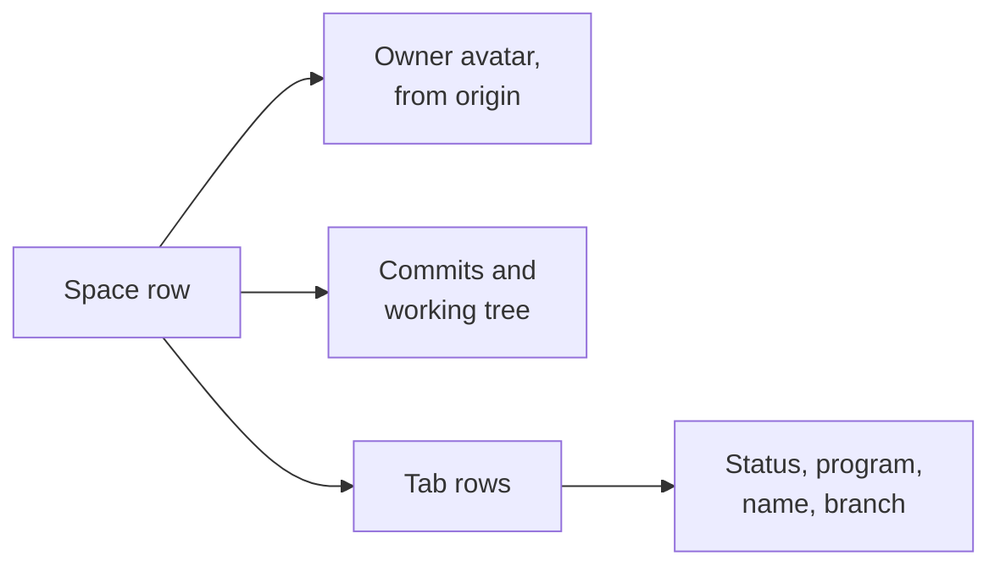

# Herdr spaces sidebar

The Spaces sidebar with each repo's GitHub owner as its avatar, the same git counts as
the shell prompt, and each tab listed under its space, unless it's settled (put away with `tab.settle`).

## Use

It needs `git` and `curl`, and no GitHub login: avatars are public. A space with no
GitHub `origin` keeps Herdr's letter tile.

- Click a tab row to go to that tab, in any space.
- A tab's status is its most urgent agent, marked as in the Agents list. A plain terminal
  has no mark.
- The git counts read as the shell prompt's do: see `git-state.sh` in dotfiles.

## Change it

Avatars are cached in the installed mod's hidden `.avatars/` folder, outside git.

`herdr-app check` renders with no spaces, so it cannot catch a bug in a row. Look at the
sidebar to test.

`spaces-avatars` is a clone, so Herdr updates never reach it. `cloned_from` in its
`mod.json` records the version. To take an update, compare it with
`~/.config/herdr-app/mods/spaces/main.js`.
