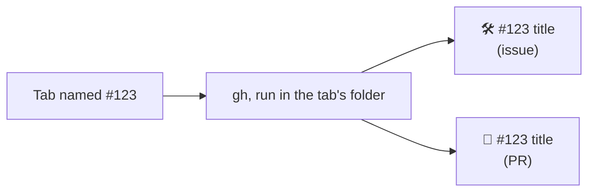

# Herdr tab title

A Herdr tab you name `#123` takes that issue's or PR's title.

## Use

It draws nothing, and runs only while the `workspace` layout's 0px `tab-title` block is shown.

- Name a tab `#123` and it becomes `🛠️ #123 <title>`, or `🔀 #123 <title>` for a PR.
- The name must be exactly `#` and digits.
- `gh` reads the repo from the tab's focused terminal's folder, so open the tab in the
  clone first.
- A failed lookup shows a toast. Rename the tab away and back to retry.
- An unnamed tab shows its agent's own title (Claude Code sets one per session) in
  `workspace-tabs`, unless the title is a path, `user@host` or the program name. The tab stays
  unnamed, so the title follows the agent.
